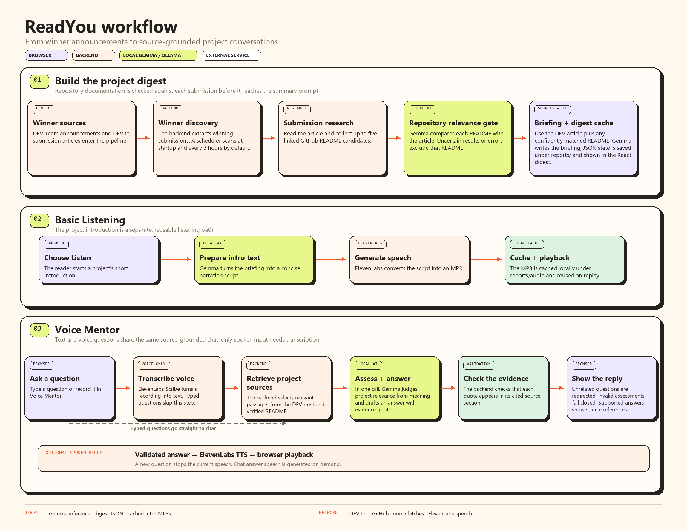

# ReadYou

ReadYou collects Hacktoberfest winner announcements and turns the projects in them into readable briefings. You can browse the winners, read a short introduction, explore the technical details, or ask questions about an individual project.

It is built as a local-first app: summaries and chat use a Gemma model served by Ollama on your machine. Speech transcription and generated voice use ElevenLabs, so those features need an internet connection and an API key.

## What you can do

- Browse Hacktoberfest winner announcements and their projects.
- Read project briefings, including the idea, implementation details, stack, and limitations when the source material supports them.
- Play a short audio introduction for a project. Generated introductions are cached locally for reuse.
- Ask questions about a project's DEV.to submission and any GitHub README that ReadYou has verified as belonging to that project. Answers include source references and can say when the available material does not support an answer.
- Use Voice Mentor to ask by text or voice and hear an answer spoken aloud. Voice questions are transcribed by ElevenLabs; Gemma produces the source-grounded answer; ElevenLabs reads it aloud. You can interrupt speech with another question.
- Optionally receive email when the scan finds new winner announcements.

## How it works



The backend checks DEV Team articles for winner announcements on startup and then on a timer. For each announcement, it finds the submissions, reads their DEV article content, and checks linked GitHub repositories. A local Gemma model classifies whether a candidate README documents the submitted project; uncertain candidates are left out. Summaries and chat use the submission and only the selected project documentation.

For project chat, Gemma assesses whether a question is about the selected project from its meaning, then drafts an answer using retrieved source passages in the same model call. The backend verifies that supporting quotes appear in their cited sections. Unrelated questions are redirected, invalid scope assessments fail closed, and the chat avoids presenting unsupported claims when the sources cannot answer.

Processed announcements, summaries, and generated audio are stored under `reports/`. This directory is local application data and is ignored by Git. Chat session history is held in backend memory and expires; it is not stored in the reports cache.

## Requirements

- Node.js (a current LTS release is recommended)
- Ollama, with the model configured for the backend available locally (default: `gemma4:e2b`)
- An ElevenLabs API key for speech transcription and spoken answers (and for generating project audio introductions)
- SMTP credentials only if you want email notifications

## Run locally

Install the backend dependencies from the repository root:

```bash
npm install
```

Install the frontend dependencies in a second step:

```bash
cd frontend
npm install
cd ..
```

Start Ollama and download the default model if needed:

```bash
ollama pull gemma4:e2b
```

Create a `.env` file in the repository root. Only the ElevenLabs settings are needed for voice and audio features; email and scan interval settings are optional. Ollama settings can be omitted when using the defaults.

```env
# Optional: these are the defaults
OLLAMA_BASE_URL=http://localhost:11434
OLLAMA_MODEL=gemma4:e2b

# Needed for ElevenLabs speech features
ELEVENLABS_API_KEY=your_api_key
ELEVENLABS_VOICE_ID=your_voice_id
# Optional overrides
ELEVENLABS_MODEL=eleven_multilingual_v2
ELEVENLABS_STT_MODEL=scribe_v2
ELEVENLABS_CHAT_MODEL=eleven_flash_v2_5

# Optional email notifications
EMAIL_USER=your_email@gmail.com
EMAIL_APP_PASSWORD=your_app_password
EMAIL_TO=recipient@example.com

# Optional; defaults to 3 hours (minimum 1)
DIGEST_SCAN_INTERVAL_HOURS=3
```

Keep `.env` private. Do not commit API keys or email passwords.

Run the backend from the repository root:

```bash
npm run dev
```

In a second terminal, run the Vite frontend:

```bash
cd frontend
npm run dev
```

Open the address Vite prints, normally `http://localhost:5173`. The Vite development server proxies `/api` requests to the backend at `http://localhost:3000`. Keep both processes running. The backend scans for announcements when it starts and every three hours by default.

## Useful commands

Run backend tests from the repository root:

```bash
npm test
```

Build the frontend:

```bash
cd frontend
npm run build
```

## API routes

All routes are served by the backend on port 3000.

| Method | Route | Purpose |
| --- | --- | --- |
| `GET` | `/api/health` | Check that the backend is running |
| `GET` | `/api/challenges/dev-articles` | List DEV Team articles |
| `GET` | `/api/winners/:articleId` | Get winners from an announcement |
| `POST` | `/api/project-research` | Research a DEV submission |
| `POST` | `/api/project-research/audio-intro` | Generate an audio introduction |
| `GET` | `/api/digests/announcements` | Find winner announcements |
| `POST` | `/api/digests/build` | Start a digest build |
| `POST` | `/api/digests/summaries/regenerate` | Start a targeted summary regeneration job |
| `POST` | `/api/digests/audio-intros/build` | Generate missing audio introductions |
| `GET` | `/api/digests/jobs/:jobId` | Check a background job |
| `GET` | `/api/digests/latest` | Get the saved digest |
| `POST` | `/api/chat` | Ask about a saved project |
| `POST` | `/api/chat/transcribe` | Transcribe a voice question with ElevenLabs |
| `POST` | `/api/chat/speech` | Speak a chat answer with ElevenLabs |
| `POST` | `/api/audio/generate` | Generate or retrieve a cached project introduction |
| `GET` | `/api/audio/files/:cacheKey` | Serve a cached audio file |

## Notes and limitations

- ReadYou depends on DEV.to and GitHub being reachable to collect project material. Some submissions have little detail or no project README, so their briefings and answers may be limited.
- The repository check is deliberately conservative. If the local model cannot confidently match a linked README to the submission, ReadYou leaves that README out rather than risk mixing in another project's documentation.
- Local model speed and answer quality depend on your computer and the Ollama model. Review source links for important technical details.
- ElevenLabs features send voice recordings or text to ElevenLabs. Project chat text and source material are sent to your local Ollama server.
- The announcement scheduler runs only while the backend process is running. Email notifications are optional and require valid SMTP settings.
- Digest state and generated audio live in `reports/`. Back up that folder if you want to keep the local cache when moving machines.

## Contributing

Issues and pull requests are welcome. Please run the relevant backend tests or frontend build for your change, and keep credentials, private data, and unnecessary generated audio out of commits.

## License

ReadYou is released under the [MIT License](LICENSE).
